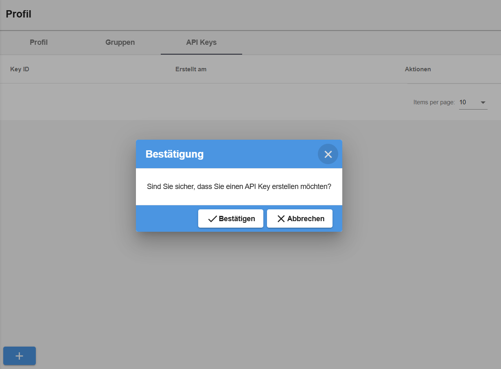
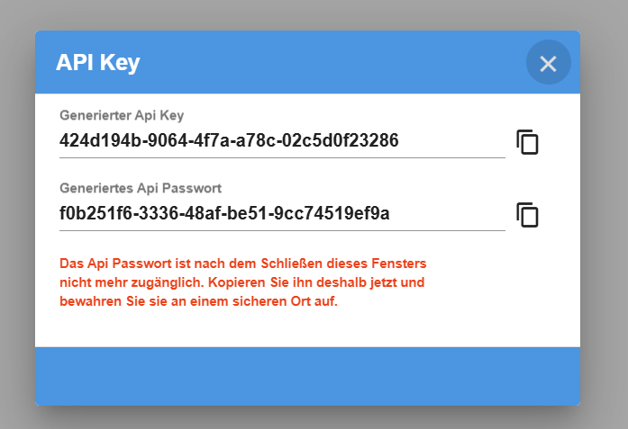
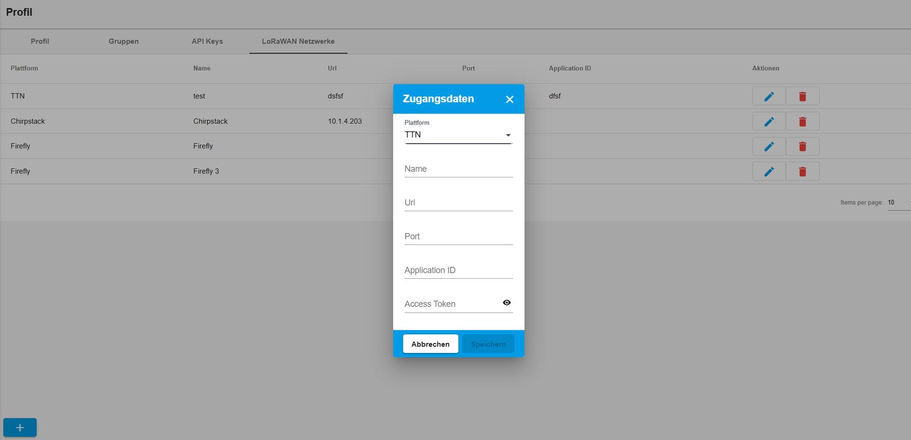

**Evrlast** is a cloud platform for the automatic collection, monitoring, and analysis of sensor data. Evrlast devices continuously measure environmental and operational parameters, transmit the data wirelessly to the Evrlast Cloud, and notify users whenever configured thresholds are exceeded. The Evrlast web [application](https://app.evrlast.com) provides a centralized dashboard for monitoring and managing all sensor data.

In addition to native Evrlast devices, **The Things Network (TTN)** can be integrated as an additional data provider. Sensor data from TTN can be forwarded to the Evrlast platform using **TTN Webhooks**, allowing you to monitor and analyze LoRaWAN devices from TTN alongside your Evrlast devices in a single platform.

## Create an Account

If you do not already have an **Evrlast account**, you first need to register:

1. Open [evrlast](https://app.evrlast.com) in your web browser.
2. Click **Sign Up** and enter your email address and a password.
3. You will receive a confirmation email. Click the link in the email to activate your account.
4. Sign in using your email address and password.

See also [evrlast documentation](https://docs.evrlast.com/cloud/account_creation/)

## Create an API Key

Open your **User Profile** and navigate to the **API Keys** tab.

1. Click **Add**.
2. Confirm the creation of the new API key in the dialog.
   
3. Once the API key has been generated, copy it from the following dialog and store it securely, as it will be required for configuring the integration.
   

See also [evrlast documentation](https://docs.evrlast.com/lorawan/api_key/api_key/)

## Create LoRaWAN Network in evrlast

You just need a **LoRaWAN Network** if you want to connect your **evrlast LoRaWAN device** in the **evrlast cloud**. Devices from other manifacturers do **not** need a **LoRaWAN Network** defined in the **evrlast** cloud.

In the **LoRaWAN Networks** tab of your user profile, you can manage the connections to your **LoRaWAN Network Servers (LNS)**.

A configured connection allows the **Evrlast Cloud** to communicate directly with your network server. This enables the platform to manage **Evrlast LoRaWAN devices** and their configuration without requiring manual interaction with the LNS.

### Configure a TTN Connection

To connect the Evrlast Cloud with **The Things Network (TTN)**, you need the following information from your TTN account:

- **Server URL**
- **Application ID**
- **Access Token**

### Server URL

The server URL is the address of your **The Things Stack** instance.

### The Things Network Community Edition

Use the base URL of your **The Things Stack** tenant:

For example:

- `https://evrlast.eu1.cloud.thethings.industries`
- `https://evrlast.eu2.cloud.thethings.industries`

If you are using a private installation of **The Things Stack**, use the URL of your own server instead.

### Application ID

The **Application ID** uniquely identifies your application within TTN.

To find it:

1. Log in to the TTN Console.
2. Open **Applications**.
3. Select the application you want to connect.
4. Copy the **Application ID** displayed on the **General Information** page.

> **Note:** The Application ID is also visible in the page URL after opening the application.

### Create an Access Token

The Evrlast Cloud authenticates with TTN using an **API Key** (Access Token).

To create one:

1. Open your application in the TTN Console.
2. Navigate to **API Keys**.
3. Click **+ Add API Key**.
4. Enter a descriptive name, for example `Evrlast Cloud`.
5. Grant the required permissions.

### Required Permissions

At minimum, the API key should have the following permissions:

- link as Application to a Network Server for traffic exchange, i.e. read uplink and write downlink

> Depending on the functionality used by the Evrlast Cloud, additional permissions may be required.

6. Click **Create API Key**.
7. Copy the generated API key immediately.

> **Important:** TTN only displays the API key once. Store it securely before leaving the page.

### Add a Connection

Open your **User Profile** and navigate to the **LoRaWAN Networks** tab.

1. Click the **+ Add** button in the lower-left corner.
2. In the **Connection Details** dialog, select the **Platform** matching your network server (**TTN**).
3. Fill in the required fields.

See also [evrlast documentation](https://docs.evrlast.com/lorawan/networks/lorawan_networks/)

### Configuration Fields

| Field | Description |
|-------|-------------|
| **Name** | A descriptive name for the connection. This name is displayed in the overview. |
| **URL** | The address of the network server. |
| **Port** | The network server port, if required. |
| **Application ID** | Identifier of the application on the network server. |
| **Access Token** | Authentication token or API key used to authenticate with the network server. Click the **eye** icon to reveal the entered value. |

4. Click **Save** to create the connection.

Click **Cancel** to discard your changes without saving.

## Create your Webhook to send data to evrlast

Use the **evrlast Webhook Template** to create your webhook.

1. Enter the username of the API key you created in the step before.
2. Enter the password of the API key you created in the step before.

## Register a New Device

After your device sent data to the **evrlast** platform, you can confirm the device request to add the device to your **evrlast device** pool. 

Open the **Device Requests** section in the Evrlast web application.

This page lists all devices that have recently connected but have not yet been assigned to your **Evrlast account**.

1. Click **Approve** next to the device you want to register.
2. If you register a evrlast device you have to select the LoRaWAN Network you created earlier.
3. Confirm the assignment in the dialog that appears.
4. The device will automatically be added to your **Device List** and is ready for use.

See also [evrlast documentation](https://docs.evrlast.com/lorawan/thing_request/thing_request/)